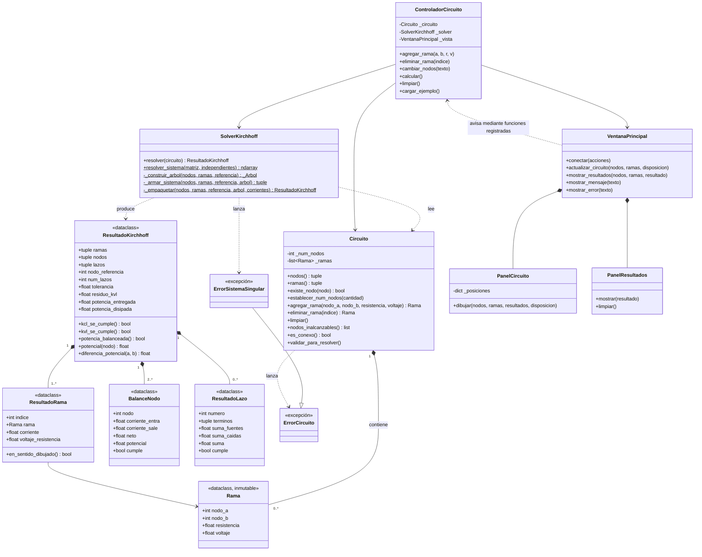

# Simulador de circuitos con las Leyes de Kirchhoff

Proyecto para el curso de **Física II**. Resuelve circuitos de corriente continua
formados por resistencias y fuentes de voltaje aplicando la **Ley de corrientes
(KCL)** y la **Ley de voltajes (KVL)** de Kirchhoff.

- Python 3, **Tkinter** para la interfaz y **NumPy** para los cálculos.
- Arquitectura **MVC estricta**: el modelo no importa nada de la vista y la vista
  no calcula nada.

## Requisitos y ejecución

Tkinter viene con Python (en Linux puede hacer falta `sudo apt install python3-tk`).
Solo hay que instalar NumPy:

```bash
pip install -r requirements.txt
```

Ejecutar la aplicación (desde la carpeta `simulador_kirchhoff`):

```bash
python main.py
```

Ejecutar las pruebas:

```bash
python -m unittest discover -s pruebas -v
```

## Cómo se usa

1. Indica el **número de nodos** del circuito. Los nodos se llaman **A, B, C…**
   (internamente son los nodos 1, 2, 3…; también puedes escribir el número).
2. Escribe **nodo inicial**, **nodo final**, **resistencia (Ω)** y **fuente (V)**
   (déjala en 0 si la rama no tiene fuente) y pulsa **Agregar rama**.
3. Pulsa **Calcular**. Verás:
   - el esquema con la corriente de cada rama,
   - la tabla de corriente y voltaje en cada resistencia,
   - la verificación de la **KCL** por nodo (con el potencial de cada nodo),
   - la verificación de la **KVL** por lazo independiente (suma de voltajes = 0),
   - el **balance de potencia** (entregada por las fuentes contra disipada).
   Las diferencias menores que 1e-9 se muestran como «≈ 0».
4. **Eliminar rama seleccionada**, **Limpiar todo** y **Cargar ejemplo** completan la botonera.

### El esquema

El circuito se dibuja como en un libro de texto: cables ortogonales, nodos como
puntos con su letra, resistencias como rectángulos de 40 × 14 px, fuentes como
baterías (placa larga = +, placa corta = −) y una flecha de corriente junto a cada rama.

- Los nodos se colocan solos (2 en vertical, 3 en triángulo, 4 en rombo, más en
  cuadrícula) y se pueden **arrastrar con el mouse**; los cables se redibujan.
- Las ramas que unen los mismos nodos se abren a los lados; si dos cables se
  cruzan sin conectarse, el horizontal hace un pequeño salto semicircular.
- La flecha apunta en el sentido dibujado; si la corriente es negativa se
  invierte y se muestra en rojo.
- Las etiquetas se acomodan solas para no encimarse con cables ni entre sí.

### Convenciones de signo

| Magnitud | Convención |
|---|---|
| Corriente `I` de una rama | Positiva si va del **nodo inicial al nodo final**. Una corriente **negativa** va en sentido contrario al dibujado. |
| Fuente `ε` de una rama | Positiva si el potencial **sube** al ir del nodo inicial al final. |
| Relación de la rama | `V_final − V_inicial = ε − R·I` |
| Potenciales | Se miden respecto al nodo A (0 V). |

### Validaciones

La aplicación avisa con un mensaje claro cuando: la resistencia no es un número
mayor que 0, un nodo no existe, el nodo inicial y el final son el mismo, hay
datos que no son números, el circuito no tiene ramas, el circuito **no es conexo**
(algún nodo queda aislado) o el sistema de ecuaciones es **singular**.

## Método de solución

Con `n` nodos y `m` ramas, las incógnitas son las `m` corrientes y se arman `m` ecuaciones:

1. **KCL** en `n − 1` nodos (el nodo 1 es la referencia y su ecuación sobra):
   `Σ I que salen − Σ I que entran = 0`.
2. **KVL** en `m − (n − 1)` lazos independientes. Se construye un árbol de
   expansión; cada rama fuera del árbol (cuerda) define un lazo fundamental.
   Para cada lazo: `Σ s·R·I = Σ s·ε`, con `s = ±1` según se recorra la rama a favor o en contra.
3. Se resuelve `A·I = b` con `numpy.linalg.solve`.
4. Se calculan `V = R·I` en cada resistencia y los potenciales de los nodos, y se
   **verifica** con la solución obtenida: la KCL en cada nodo, la KVL en cada
   lazo (`Σ s·(ε − R·I) = 0`) y que la potencia entregada por las fuentes
   (`Σ ε·I`) sea igual a la disipada (`Σ R·I²`).

### Ejemplo base (verificado en las pruebas)

Fuente de 12 V con R1 = 2 Ω en serie con R2 = 6 Ω en paralelo con R3 = 3 Ω,
entre los nodos A (arriba) y B (abajo). «Cargar ejemplo» lo deja dibujado igual
que el esquema de la maqueta:

| Resultado | Valor |
|---|---|
| I1 | 3 A |
| I2 | 1 A |
| I3 | 2 A |
| Vab = V(A) − V(B) | 6 V |
| Potencia entregada = disipada | 36 W |

## Estructura del proyecto

```
simulador_kirchhoff/
├── main.py                      # arranca la aplicación
├── requirements.txt
├── README.md
├── modelo/
│   ├── rama.py                  # Rama: nodo_a, nodo_b, resistencia, voltaje
│   ├── circuito.py              # Circuito: nodos, ramas y validaciones
│   └── solver_kirchhoff.py      # arma y resuelve el sistema
├── vista/
│   ├── ventana_principal.py     # formulario, lista de ramas y botones
│   ├── panel_circuito.py        # Canvas que dibuja el circuito
│   └── panel_resultados.py      # tablas de corrientes, voltajes y KCL
├── controlador/
│   └── controlador_circuito.py  # une la vista con el modelo
└── pruebas/
    └── test_solver.py           # pruebas con unittest
```

Los archivos `__init__.py` vacíos de cada carpeta solo marcan los paquetes de Python.

### Reglas de dependencia (MVC)

- `modelo` no importa nada de `vista` ni de `controlador`.
- `vista` no importa nada de `modelo`: solo muestra lo que recibe y avisa al
  controlador de lo que hace el usuario mediante funciones que este le registra.
- `controlador` es el único que conoce a las dos partes. `main.py` las crea y las conecta.

## Diagrama UML de clases


